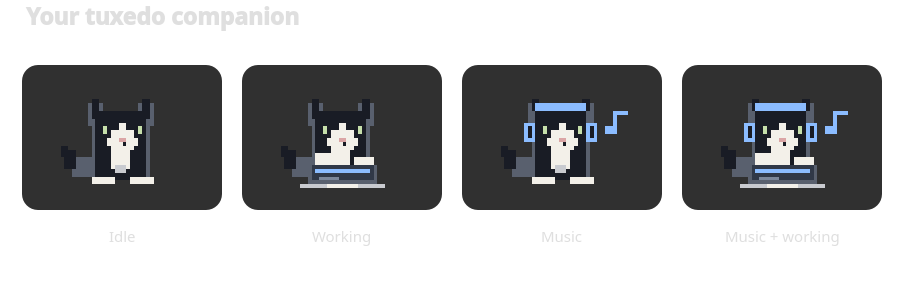
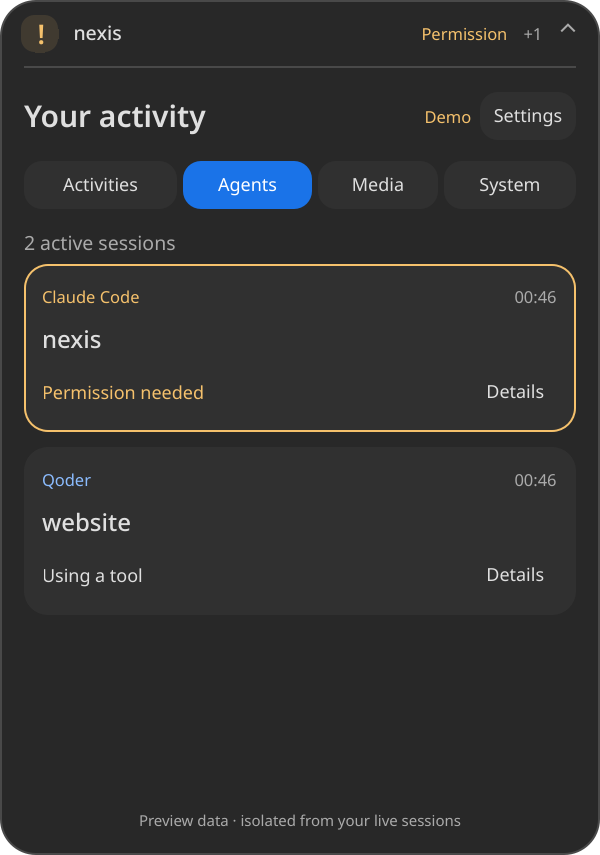

# NEXIS

**Current UI: NEXIS · Tuxedo is installed in your top KDE panel.** The cat is always visible; idle shows clock/date, music shows the track title and headphones, agent work shows typing, and combined activity shows both. Response completion appears for four seconds. Click the panel pet to open controls. See [panel usage and installation](docs/PANEL.md).



A native Qt6 desktop activity island for KDE Plasma Wayland. Music, Claude Code, **the new Qoder desktop app**, local jobs, and essential system indicators live in a small floating capsule.



The default appearance follows your KDE colors, font and icon theme. This build was developed against **Orchis Dark, Tela Circle Dark, Plasma 6.7.5 and Qt 6.10.3 on Fedora 43**. It is real desktop software, with an explicitly labeled, isolated demo mode.

## Build and standalone preview

With Qt6 development files and LayerShellQt 6.7+ installed:

```bash
cmake -S . -B build -DCMAKE_BUILD_TYPE=RelWithDebInfo
cmake --build build -j4
ctest --test-dir build --output-on-failure
./build/nexis
```

On this Fedora machine, development files were extracted locally rather than installed system-wide:

```bash
./scripts/bootstrap-fedora.sh
./build/nexis
```

The bootstrap requires installed Qt6 runtime, LayerShellQt, CMake, a C++ compiler, OpenGL development files, Python3, `dnf download`, `rpm2cpio` and `cpio`. It downloads matching development RPM versions from Fedora repositories into ignored `.deps/`. No root access or RPM database changes.

For a lower-overhead software renderer or a preview while the desktop is locked, use `QT_QUICK_BACKEND=software ./build/nexis`. GPU frame callbacks may pause behind the lock screen.

Useful commands:

```bash
./build/nexis doctor
./build/nexis --demo --expanded             # isolated preview, not live agents
./build/nexis --snapshot                    # read-only JSON from the running instance
./build/nexis --headless                    # collector without a window
./build/nexis --windowed                    # fallback when layer-shell is unavailable
```

Only one live instance and one isolated demo may run at a time. Click to expand; Escape or focus loss collapses. Drag the capsule to move it. Settings include desktop/light/dark themes, reduced motion, optional 350 ms hover expansion, display/offset selection, middle-click behavior, fullscreen overlay, activity pinning and memory-only history. There is no global keyboard shortcut by default.

### Ubuntu 24.04

The [Ubuntu package index](https://packages.ubuntu.com/noble/qt6-base-dev) provides Qt 6.4.2; install these development/runtime packages through your package manager:

```text
build-essential cmake python3 dbus qt6-base-dev qt6-declarative-dev
qt6-declarative-dev-tools qt6-wayland qml6-module-qtquick
qml6-module-qtquick-window qml6-module-qtquick-controls
qml6-module-qtquick-layouts qml6-module-qtquick-templates
qml6-module-qtqml-workerscript
```

Ubuntu 24.04's [liblayershellqtinterface-dev](https://packages.ubuntu.com/noble/liblayershellqtinterface-dev) is a **Qt5 / Plasma 5.27 package**, so it cannot supply NEXIS's Qt6 layer-shell integration. A Plasma 6 distribution or a separately provided Qt6 LayerShellQt **6.7+** is required for the tested anchored Wayland behavior. Without it, NEXIS builds a regular floating Qt window, with compositor-dependent positioning. Ubuntu builds have not been run on this Fedora host. Audio actions additionally require WirePlumber's `wpctl`; network and battery use NetworkManager and UPower.

## Connect your agents

Hook installation is opt-in. Review the filtered diff, then install:

```bash
./build/nexis hooks install --provider claude --dry-run
./build/nexis hooks install --provider claude
./build/nexis hooks install --provider qoder --dry-run
./build/nexis hooks install --provider qoder
./build/nexis hooks status --provider qoder
```

**Qoder means the new desktop app (tested installation: 0.4.4 at `/opt/Qoder/qoder`), not Qoder IDE or standalone CLI.** It shares `~/.qoder/settings.json` with other Qoder products; hook payloads do not reliably identify which shared-config product emitted them. Avoid simultaneously using those products if you require exact attribution. Live delivery from the desktop app is unverified until an event reaches NEXIS. No prompts or agent commands are needed to install this software, and the installer never starts paid agent work.

Restart the app or start a fresh task to ensure hooks are loaded. Existing hooks are preserved. Installation creates private timestamped backups and atomically replaces settings; malformed or symlink settings are refused. Removal deletes only NEXIS-marked handlers:

```bash
./build/nexis hooks uninstall --provider claude
./build/nexis hooks uninstall --provider qoder
```

Use `--settings /path/to/settings.json` to test merges in a separate file. The bridge always exits successfully, writes nothing to stdout, bounds stdin/connection/write time, and discards private fields before sending. There is no permission approval action in NEXIS. See [hook details](docs/HOOKS.md).

## Music and system

NEXIS discovers `org.mpris.MediaPlayer2.*` services, follows metadata/playback changes, lets you select a player, and disables unsupported controls. Seeking uses the selected track's MPRIS ID. Remote artwork is never fetched; bounded local raster artwork is allowed. Play music in an MPRIS-capable app to connect it.

NetworkManager and UPower provide network/battery state. WirePlumber `wpctl` reads output volume and changes it only from a user-operated control. The runtime-only KWin observer hides the island on a display with a fullscreen window; Settings can explicitly enable overlay. It receives output names and fullscreen state, never window titles. Missing APIs are reported as unavailable or degraded.

## Local job API

Build scripts can publish validated progress without exposing commands or outputs:

```bash
./build/nexis job started --id website-build --label 'Website build'
./build/nexis job progress --id website-build --label 'Website build' --progress 45
./build/nexis job completed --id website-build --label 'Website build'
```

Supported events: `started`, `progress`, `completed`, `failed`; IDs are 1–64 ASCII letters/digits/underscore/hyphen, labels are 1–64 letters/digits/spaces and basic punctuation, and progress is an integer 0–100. The same private socket accepts this strict schema; other keys are rejected. See [architecture](docs/ARCHITECTURE.md).

## Install and autostart

```bash
cmake --install build --prefix "$HOME/.local"
systemctl --user daemon-reload
# Optional, explicitly enable autostart:
systemctl --user enable --now nexis.service
```

The user service targets the standard `~/.local/bin/nexis` installation. For another prefix, use a systemd override with your binary path. No autostart is enabled by building or installing. Disable with `systemctl --user disable --now nexis.service`. The desktop launcher and scalable icon are installed alongside the application.

## Verification and limits

```bash
ctest --test-dir build --output-on-failure
python3 scripts/benchmark.py --duration 600 --output docs/benchmark-idle.json
```

Tests cover both provider state machines, redaction, parallel sessions, stale/replayed events, reversible settings merges, real Unix-socket ingestion, fail-open bridge behavior, two isolated MPRIS players and reconnect, job validation, priority, per-screen fullscreen state, and QML click/Escape/reduced-motion behavior. Isolated test players never enter the user's live bus.

See [verification](docs/VERIFICATION.md), [privacy](docs/PRIVACY.md) and [known limitations](docs/KNOWN_LIMITATIONS.md). Optional notification/download bridges and advanced sensors are unavailable in this release. The original technical spec is retained; the user's correction to target the **new Qoder app** takes precedence over its IDE-specific text.
